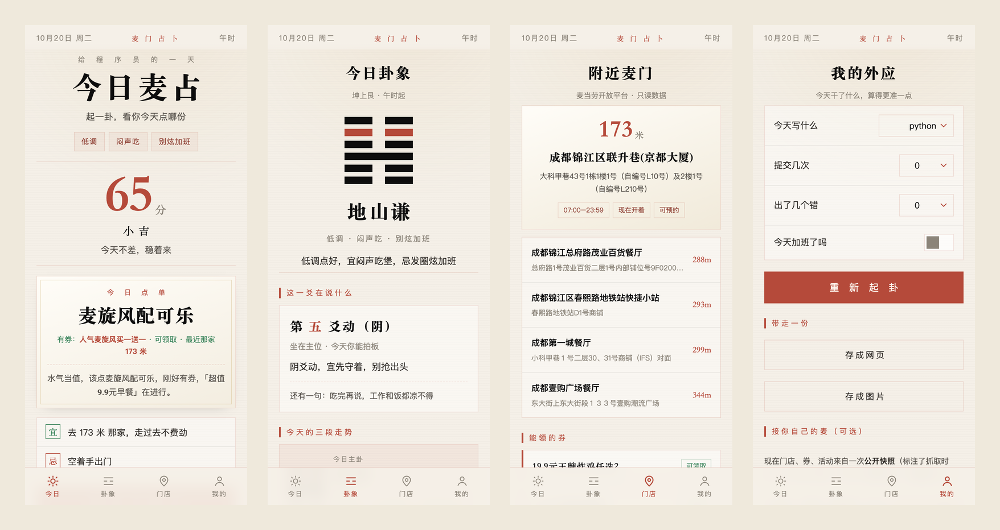
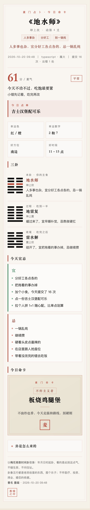

# 麦门占卜（maimen-zhanbu）

**在线体验 → <https://midark.github.io/maimen-zhanbu/>**（纯前端，零输入，不用填 Token；打开即查真实门店/券/活动）

> **麦门占卜 · 程序员麦占** —— 卦是正经梅花易数时间卦，话全说人话。点一下按钮，三秒告诉你**今天该点哪一份**：
> 以**当前时辰起卦**（零输入，不碰生辰八字），可选用今日 commit / bug / 加班作外应，
> 给一句麦门式的宜忌，抽一张命卡，再接麦当劳 MCP **只读真实数据**落到「去哪家店、领什么券」。
>
> 不用懂「体用生克」也能看懂结论；想追根究底的，术语都收在「卦是怎么来的」折叠里。

<p align="center">
  
</p>

<p align="center"><sub>今日 → 卦象 → 门店 → 我的。首屏只有「今天点哪份」，其余都在别的页里</sub></p>

<p align="center">
  
</p>

<p align="center"><sub>Skill 产出的本地命卡（<code>file://</code> 双击直开）</sub></p>

## 为什么是它（差异化）

- 程序员节（1024）整活 + 玄学 + 麦门梗，三位一体。
- 现有榜单多是**西式 fortune / MBTI / 省钱比价**；本项目做 **中式梅花易数 / 命理口吻 × 程序员梗**，口吻与视觉完全错位，蓝海。
- 视觉不是「暗色特效风」，而是直接承接已验证的**命理全鉴新国风**（宣纸底 / 墨黑 / 朱红 / 描金），见下节。

## 设计（承接命理全鉴，非暗色特效）

同一套设计令牌贯穿网页、命卡、小程序三端，与「命理全鉴」报告页同源：

| 项 | 取值 |
|---|---|
| 底色 | 宣纸 `#F5F0E8`（暖纸 `#EDE6D6` / 冷纸 `#E8E2D4`） |
| 墨色 | `#0D0D0D → #A0A0A0` 六级墨阶 |
| 主色 | 朱红 `#B54A3A`（深 `#8B3A2E`） |
| 点缀 | 描金 `#C4A35A`、吉绿 `#2f7d52` |
| 字体 | 标题 Noto Serif SC / 宋体；正文 Noto Sans SC / 苹方 |

版式与动效同样沿用其范式：细顶栏 + 卷首 + 深色引文带 + 墨喵之印页脚；动效只用 `.reveal` 滚动显现、卡片底色变化，不做全屏滤镜与毛玻璃。

**版式是「单页应用 + 底部切页」，不是长页滚动**。WorkBuddy 默认在右侧竖栏打开，用户也多半在手机上刷到，
长页滚动的结果就是首屏塞满、后面没人看。所以按 App 的方式切：

| 页 | 装什么 | 为什么单独成页 |
|---|---|---|
| **今日** | 大标题（居中）→ 麦气分 → 今日点单 → 宜 / 忌 → 抽命卡 | 一屏装完，只回答「今天吃哪份」 |
| **卦象** | 主卦卦画 → 这一爻 → 三段走势 → 体用 → 幸运物 →（折叠）来由 | 想深挖的人自己点进来 |
| **门店** | 真实门店 / 券 / 活动 / 积分 | MCP 的数据都在这里，不干扰首屏 |
| **我的** | 外应输入 / 重算 / 存网页 / 存图 / 声明 | 低频操作集中收口 |

具体到视觉：

| 做法 | 原因 |
|---|---|
| 正文 17px / 行高 1.72，主标题 `clamp(40px,11.5vw,52px)`，麦气 92px | 竖屏要大字，先抓眼睛 |
| 标题、卦名、分数一律居中 | 手机竖屏的视觉重心在中轴 |
| 正文单列最大 `480px`，PC 上只是一张居中竖卷 | 宽屏铺开反而难读 |
| 底部 4 个 Tab 固定（`safe-area` 适配），内容区预留 66px | 拇指可达，不遮内容 |
| 三卦、宜忌竖排 | 390px 下三列并排会挤成一团 |
| 术语收进 `<details>` / 折叠 | 默认只给结论 |

三端统一的仪式感：**起卦 → 焚香净手遮罩 → 六爻自下而上逐爻显现 → 麦气与点单落定**；命卡为弹出卡片。

## 三种玩法（同一套命理内核）

| 形态 | 路径 | 适合 | 状态 | 能不能查实时 |
|---|---|---|---|---|
| **技能版（参赛主体）** | `skill/SKILL.md` | WorkBuddy 对话触发，产出**本地可打开的网页命卡** | 可用 | 能：连接器直连，用你自己的 Token |
| **网页体验版** | `web/index.html` | 浏览器/手机直接打开 | **已上线**：<https://midark.github.io/maimen-zhanbu/> | 能：**开页即实时**（站点自带只读中转），也可填自己的 Token |
| **小红书小工具版** | `minitool/` | 离线 H5 zip，上传创服平台的小工具 | 产物就绪，待上传 | 不能：容器禁联网，用快照；内有二维码 + 存图，可扫码去网页版看实时 |

> **`miniprogram/` 是什么？** 最早按小程序风格（`.xhsml`/`app.json`）写的原型，留着参考，
> **不是**上传物。真正上传创服平台的是 `minitool/` 里打出来的 zip（离线 H5 容器规范）。

> **为什么网页版查实时需要一个中转？**
> `mcp.mcd.cn` 不返回任何 `Access-Control-Allow-Origin` 头（OPTIONS 预检直接 403），
> 浏览器端即使拿到 Token 也发不出请求。所以配了 `server/server.js`——一个零依赖
> Node 单文件服务，已用 WorkBuddy 应用托管部署在
> `https://maimen-mcp-proxy.app.workbuddy.host`，网页打开自动查真实门店 / 券 / 活动。
> 服务端只放行 `tools/call` 的**只读白名单**（下单 / 领券 / 抽奖一律 403）、只转发
> `mcp.mcd.cn`、单 IP 限流，内置 Token 不写日志。
>
> **为什么小工具版不能查实时？**
> 小红书小工具是离线 H5 容器，官方文档 §4.2 明确禁用 `fetch` / `XMLHttpRequest`，
> FAQ 也写明「网页不能通过 fetch、XMLHttpRequest 请求外部服务」，平台只提供存相册、
> 本地存储、平台 AI 文本生成，没有任何请求代理能力。所以小工具里只能用快照，
> 页面会如实标注抓取时间。
>
> **那小工具怎么把人送到网页版？** 平台同样禁了 `window.open` / `target="_blank"` /
> 跳转站外 URL，`navigator.clipboard` 和 `execCommand('copy')` 也被禁用，且 API 清单里
> **没有** `setClipboardData` 之类的能力 —— 也就是说「点按钮打开网页」「点按钮复制链接」
> 这两件事在小工具里都做不到。可用的只有三条：① 页面内直接显示**二维码**让另一台手机扫；
> ② `writeTempFile` + `saveImageToPhotosAlbum` 把二维码**存进相册**，再用微信
> 「扫一扫 → 相册」识别；③ 展示**可选中文本**的地址。区块在「我的 → 查实时 · 去网页版」，
> 今日页底部也放了一个直达按钮；客户端 9.49+ 额外给一个
> 「把地址带到评论区」（`interactionOpenApi`）的入口。二维码由 `scripts/make_qr.py` 生成，
> 构建时内联成 data URI，包里不含任何外部请求。

### 数据新鲜度

| 环节 | 怎么更新 |
|---|---|
| 仓库里的快照（`web/mcd_data.js` 等三份） | `.github/workflows/refresh-mcd-data.yml` 每 3 小时用仓库 secret `MCD_MCP_TOKEN` 自动抓一次 |
| 网页版默认数据 | **开页自动实时查一次**（走站点自带中转）；查不到才退回快照，页脚显示抓取时间 |
| 小工具包 | 每次重新打包时带上当时最新的快照；包内是离线的，不会自己变新 |
| 你自己填了 Token 的话 | 点「查我的实时数据」用**你的账号**查（积分、我的券），不依赖快照 |

### 服务端中转（已部署，自建也可）

线上地址：`https://maimen-mcp-proxy.app.workbuddy.host/mcp?sharecode=W3MDNRGPQK`（已写进 `web/mcd_live.js` 的 `DEFAULT_PROXY`）。

自己再搭一份：

```bash
cd server && cp config.example.json config.json   # 填 token，config.json 不入库
PORT=3000 node server.js
```

备选：`tools/mcp-proxy-worker.js`（Cloudflare Worker 单文件版），只做透传、不带 Token，
需要浏览器侧自带 Token。

## 特性

- 🔮 梅花易数时间卦（零输入，以当前年+月+日+时起卦；本卦 / 互卦 / 变卦 + 六爻卦画 + 动爻）
- ⚖️ 体用生克断吉凶（动爻分体用，五行论生克，得比和 / 用生体 / 体生用 / 体克用 / 用克体五局）
- 🃏 程序员外应映射（语言→五行、commit/bug/加班→外应）+ 麦门命卡抽卡（巨无霸=双层至尊…），单文件 HTML 命卡
- 🎯 一卦给六样东西：三个关键词、这一爻的阶段、三段走势（本/互/变）、体用生克、今日幸运物（色/数/方位/时段）、今日点单
- 💬 说人话：「宜蓄着待发」写成「劲攒足了，宜蓄着待发，忌现在就 all in」，64 卦断语全部麦门化
- 🍔 麦当劳 MCP **只读**真实数据接入（门店 / 券 / 活动 / 积分），真实数据驱动「点单、宜忌、门店页」；`scripts/fetch_real.py` 一条命令抓成快照
- 🧘 纯离线可跑：没 Token 也能出一张命卡（拉 Star 友好）
- 📱 自包含 HTML，零外链、`file://` 双击直开、断网可看；右下角悬浮「存网页 / 存整页图」便于小红书转发

## 安装（WorkBuddy 用户）

1. 申请麦当劳 MCP Token：`https://open.mcd.cn/mcp`（登录 → 控制台 → 激活 → 复制）
2. WorkBuddy 左侧【专家·技能·连接器】→【连接器】→【自定义连接器】→【配置 MCP】，填入：

```json
{
  "mcpServers": {
    "mcd-mcp": {
      "type": "streamablehttp",
      "url": "https://mcp.mcd.cn",
      "headers": { "Authorization": "Bearer 你的MCP_TOKEN" }
    }
  }
}
```

3. 安装本技能：把 `skill/` 目录作为 WorkBuddy 技能载入（或复制 `skill/SKILL.md` 到技能目录）。
4. 对话：「帮我用麦门占卜算今日运势」（可顺带报 commit / 语言 / 加班作外应）。
5. 技能会生成一张**本地网页命卡**（`麦门命卡.html`），双击即可查看，可存图发小红书。

## 快速体验（无需 Token / 无需 WorkBuddy）

```bash
# 零输入：纯凭当前时辰起卦
python scripts/fortune_engine.py --out fortune.json
# 或带程序员外应（可选）
python scripts/fortune_engine.py --lang python --commits 12 --bugs 1 --overtime --out fortune.json
# 渲染成自包含命卡网页
python scripts/demo_offline.py --data fortune.json --out 麦门命卡.html
# 双击 麦门命卡.html 即可查看（新国风命书折页，零外链）
```

### 接入真实门店与券（可选）

网页是静态的（`file://` 双击直开、零外链），不能自己发请求，也不能把 Token 写进页面。
所以由本地脚本抓一次、落成快照给页面引用：

```bash
MCD_MCP_TOKEN=你的TOKEN python3 scripts/fetch_real.py --city 成都 --keyword 春熙路
# → web/mcd_data.js 与 assets/mcd_data.js，页面立即出现真实门店 / 券 / 活动 / 积分
```

默认**全脱敏**：个人积分三项一律写 `null`（页面显示「积分已脱敏」），便于安全提交。
要连自己的积分一起写加 `--with-account`，但**别把结果提交进仓库**。没跑这一步，页面会显示「尚未接入真实数据」，其余功能照常。

> 想直接在手机/浏览器玩？打开 <https://midark.github.io/maimen-zhanbu/>（纯前端，无 Token）。`miniprogram/` 是同款小红书小工具版，结构已按规范写好、待提交审核。

## 目录

```
skill/SKILL.md              技能定义（触发词/工作流/文风铁律/红线）
scripts/fortune_engine.py   梅花易数时间卦 + 体用生克 + 外应宜忌 + 抽卡（离线可跑）
scripts/mcp_client.py       麦当劳 MCP 只读客户端（含包装文本解析，结构化输出）
scripts/fetch_real.py       抓一次只读数据 → web/mcd_data.js 快照（默认脱敏）
scripts/demo_offline.py     离线命卡生成（拉 Star 关键）
assets/ming_card.html       单文件命卡模板（命书折页，宣纸朱红）
assets/avatar-512.png       技能头像（512×512，麦当劳红黄；build/make_avatar.py 生成）
web/index.html              纯前端单页应用（今日/卦象/门店/我的，开页自动查实时）
web/mcd_live.js             浏览器侧 MCP 只读客户端（走站点自带中转，Token 可留空）
web/mcd_data.js             真实数据快照（脱敏，可安全提交；实时查不到时兜底）
server/server.js            麦当劳 MCP 只读中转（零依赖 Node 单文件，已托管部署）
tools/mcp-proxy-worker.js   同一中转的 Cloudflare Worker 备选版（透传 Token）
miniprogram/                小红书小程序版（结构就绪，待提交审核；app.js/app.json/app.css + pages/index/*.xhsml）
miniprogram/data/mcd_real.js 同一份快照（小程序 require，兜底）
miniprogram/utils/mcd_api.js 小程序端 MCP 只读客户端（实时优先，快照兜底）
miniprogram/config/token.example.js 复制成 token.js 填 Token（token.js 不入库）
samples/                    生成样例（命卡成品，可直接双击查看）
references/mcd_mcp_tools.md 实测 35 工具清单与坑
```

### 三端一致性

`scripts/fortune_engine.py` 为唯一真源；`web/index.html` 与 `miniprogram/pages/index/index.js` 内嵌同一套 64 卦表与推导式。

对拍不靠人眼：`scripts/verify_parity.py` 把两端 JS 的纯计算区切出来丢进 Node 求值，与 Python 在 **6 个时点 × 3 端 × 19 项**（本卦 / 互卦 / 变卦 / 动爻 / 三组卦画 / 上下卦数 / 体用 / 卦气 / 评分 / 命卡）逐项比对。

```bash
python3 scripts/verify_parity.py
# → ALL MATCH：6 个时点 × 3 端 × 19 项，全部一致
```

卦理另有两道自检：八卦爻象逐一比对传统卦象（乾阳阳阳 … 坤阴阴阴）、64 卦「上下卦 → 六爻 → 解码回上下卦」往返 64/64。变卦由**卦画翻爻回推**而非位运算，「画」与「名」强制同源，不可能再出现画一套、报一套。

## 合规

- 仅调用麦当劳 MCP **只读**工具，绝不触发下单 / 领券 / 抽奖等写操作。
- 命理仅作趣味包装，不构成专业建议；餐品与优惠以麦当劳官方实时数据为准。
- 参赛声明见 `CONTEST_DECLARATION.md`（内容不可改）。

> 本项目为麦当劳程序员节创意开发大赛参赛作品，非麦当劳官方产品。

## 许可

MIT —— 见 [LICENSE](LICENSE)。卦是古人的，代码是这个项目的；麦当劳的商品名、券与门店信息归麦当劳所有。
